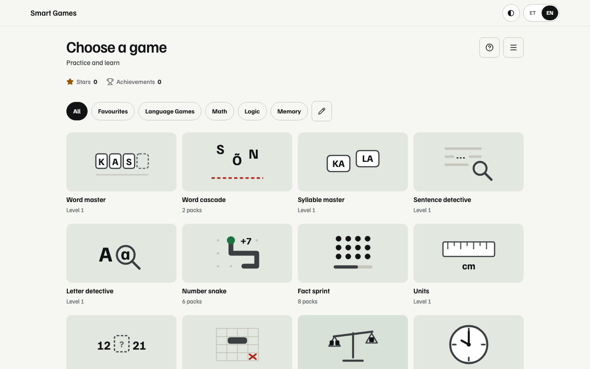

# khe-study

[](https://github.com/khelias/khe-study/actions/workflows/ci.yml)
[](https://github.com/khelias/khe-study/actions/workflows/codeql.yml)
[](https://github.com/khelias/khe-study/actions/workflows/deploy.yml)

**Smart Games**: small learning games for the Estonian curriculum, reading,
math, logic and memory, in Estonian and English, for children practising at
home. Live at [games.khe.ee/study/](https://games.khe.ee/study/).

[](https://games.khe.ee/study/)

## How it works

The idea behind it is that one engine can serve both a 7-year-old practising
multiplication and an adult practising Estonian river names: one codebase,
one learner model, two UX registers. Today it is the children's catalogue;
a backend, the adult register and the remaining bounded-context moves are
next ([ROADMAP.md](ROADMAP.md)).

- **Difficulty adapts on two axes.** Each game mechanic has its own level,
  and each skill has its own mastery, so a learner can be on a hard level of
  a simple mechanic and still get the facts they keep missing. For closed
  sets like the multiplication table, practice leans towards the weakest
  facts and keeps revisiting the known ones.
- **Games are played in rounds** of a few tasks with lives of their own;
  a wrong answer costs a life and the next round starts full. A round that
  reaches its goal gives stars, and enough of them raise the level. **Levels are earned, never bought.** Stars buy background themes
  and hints. Achievements are cosmetic.
- **Several learners share one device**, each with their own progress and
  chosen theme; stars, bought themes and achievements are still shared per
  device.
- Everything is stored in the browser. Nothing syncs across devices yet.

The numbers behind these rules live in `src/engine/` (`progression.ts`,
`adaptiveDifficulty.ts`, `factDrill.ts`); the games themselves are registered
in `src/games/registrations.ts`.

## Run it

Needs Node.js (the version in `.nvmrc`) and npm.

```bash
git clone https://github.com/khelias/khe-study.git
cd khe-study
npm install
npm run dev       # http://localhost:5173/study/
npm run test:run
```

Every other command and the quality gate CI enforces are in
[AGENTS.md](AGENTS.md).

## Where it runs

Every push to `main` builds on a self-hosted runner on the homelab VM and
copies the static site into the directory the
[khe-homelab](https://github.com/khelias/khe-homelab) nginx serves. There is
no server component yet.

## More

- [ARCHITECTURE.md](ARCHITECTURE.md) - current code structure
- [docs/decisions/](docs/decisions/) - architecture decisions: bounded
  contexts, the learner profile, the CodeQL insecure-randomness exclusion
- [ROADMAP.md](ROADMAP.md) - phases, non-goals, open decisions
- [docs/shared-components.md](docs/shared-components.md) - cookbook for the
  shared game components
- [src/i18n/README.md](src/i18n/README.md) - the translation system
- [AGENTS.md](AGENTS.md) - commands, layout and rules for working on the code

## Licence

MIT, see [LICENSE](LICENSE).
